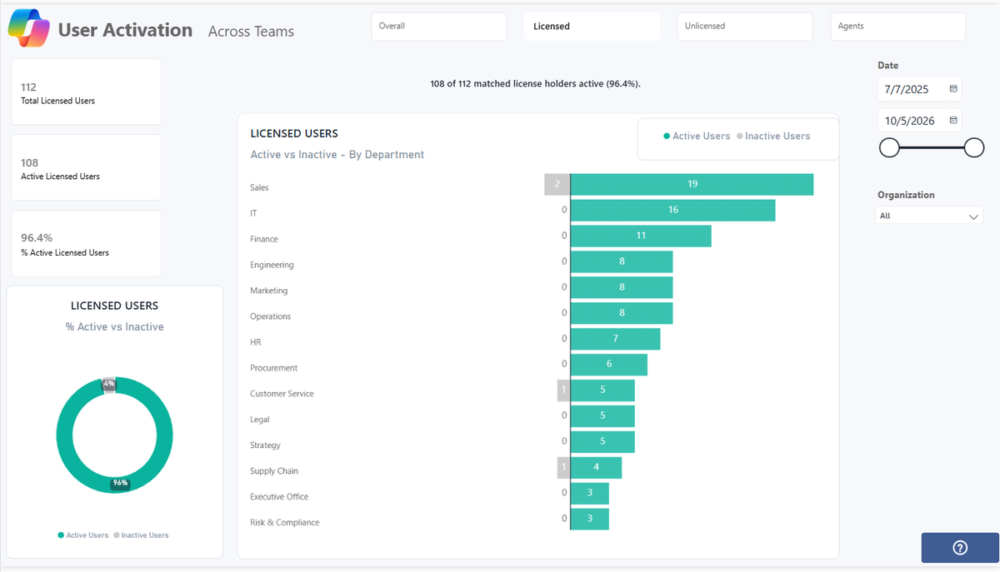
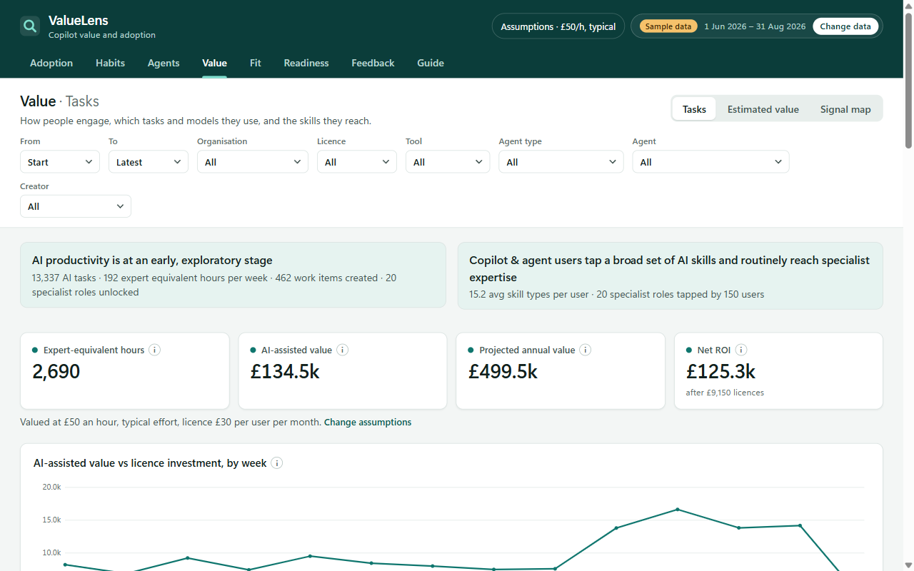
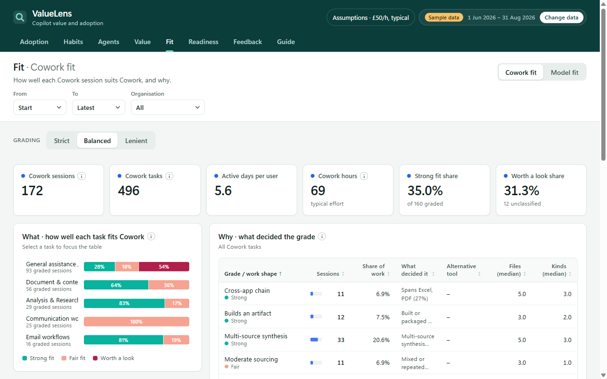
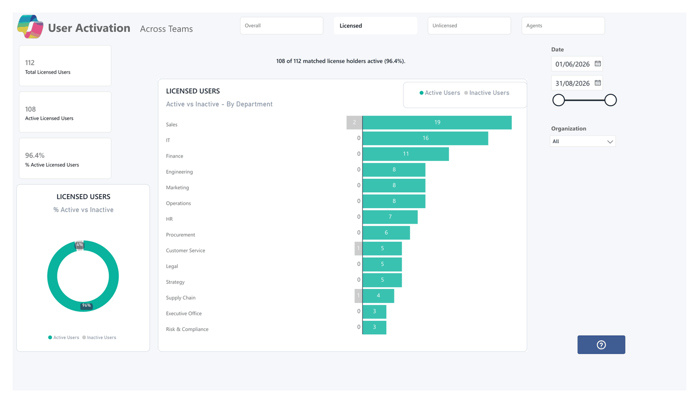
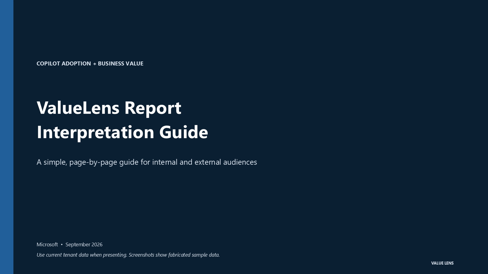

 

# 🔍 ValueLens for Microsoft Copilot

**The hours and value Microsoft 365 Copilot and agents deliver, as an app or a Power BI report.**

 

All reports and guides can be found on the [Analytics Hub](https://microsoft.github.io/Analytics-Hub/).

**Also see [Analytics Hub for Microsoft Copilot](https://github.com/microsoft/AnalyticsHub-Dashboard):**
one installer sets up an app on Microsoft Fabric or Azure that shows Copilot and agent adoption,
value, consumption and governance in one place. It includes the ValueLens report.

 

**Found this useful? ⭐ Star this repo to help others discover it!**

 

**[Before you start ↓](#before-you-start)** &nbsp;·&nbsp; **[Choose your path ↓](#choose-your-path)** &nbsp;·&nbsp; **[After setup ↓](#after-setup)** &nbsp;·&nbsp; **[Watch the demo ↗](https://youtu.be/P0uHJb13ZR0)**

 

<table>
<tr>
<th width="50%">The app</th>
<th width="50%">The Power BI report</th>
</tr>
<tr>
<td></td>
<td></td>
</tr>
<tr>
<td></td>
<td></td>
</tr>
</table>

All screenshots use synthetic sample data. Every name in them is invented.

## Videos

- **[Watch the demo](https://youtu.be/P0uHJb13ZR0)** (2 minutes). What the dashboard shows, page by page.
- **[Watch the Fabric setup](1.%20Fabric/README.md#video)**. From a new app registration to a self-refreshing report.
  Or [download the video](https://github.com/microsoft/ValueLens-for-Microsoft-Copilot/releases/download/installer-v0.2.2/ValueLens_Fabric_Setup.mp4).

## What you get

- **An app** that shows how your organisation uses Microsoft 365 Copilot and agents.
- **The hours and value** that Copilot and agents deliver, by team, tool and task.
- **A Power BI report** with the same numbers, if you prefer Power BI.

## Before you start

- [ ] **Read the [disclaimer](#disclaimer).** This isn't the official Copilot report. You own the data it extracts.
- [ ] **Licences.** App viewers need Power Apps Premium or Copilot Credits. Report viewers need Power BI Pro.
- [ ] **A place for the data.** A Fabric capacity (F2 or larger, or a
      [free trial](https://learn.microsoft.com/fabric/fundamentals/fabric-trial#method-1-start-a-new-trial-capacity-from-the-account-manager)).
      Or an Azure subscription, a SharePoint library, or just your PC.
- [ ] **Admin help.** A Global Administrator approves read-only Microsoft Graph permissions
      (not needed for Local CSV). A Power Platform Administrator allows managed apps.
- [ ] **Tools.** Windows 10 or 11. Power BI Desktop, June 2024 or later.
      For the app: Node.js 24.11 or later, Git and the `ms` tool.

The full checklist, by who does what, is in [Before you start](docs/PREREQUISITES.md).
Every permission is explained in [Permissions](docs/PERMISSIONS.md).

## Choose your path

| Path | Who it suits |
|---|---|
| **[Installer](#installer)** (recommended, fastest) | Most people. It asks a few questions, then sets everything up for you. |
| **[Manual](#manual)** (step by step) | People who want to control each step, or can't run the installer. |

## Installer

> **Coming soon:** a ValueLens installer ([#216](https://github.com/microsoft/ValueLens-for-Microsoft-Copilot/pull/216)).
> Until then, use the Analytics Hub installer. It sets up ValueLens on Fabric or Azure, with an app.
> It's a work in progress, so try it in a test tenant first.

1. **Send each admin their part** of the [checklist](docs/PREREQUISITES.md).
2. **Download** [AnalyticsHubInstaller.exe](https://github.com/microsoft/ValueLens-for-Microsoft-Copilot/releases/latest/download/AnalyticsHubInstaller.exe).
   If Edge or Windows warns you, see [Check the download](1.%20Fabric/installer/README.md#check-the-download).
3. **Open it.** After about a minute, it opens in your browser. Keep its window open.
4. **Choose Set up Analytics Hub** and sign in with your work account.
5. **Answer the questions.** Pick Fabric or **Your Azure subscription**, then the data you want.
   Choose **No** for advanced settings to take the defaults.
6. **Approve the plan.** Nothing is created until you do. Setup takes about 15 minutes.
7. **Check it worked.** Open the app link it gives you. The first data arrives about 25 minutes later.

More detail: [on Fabric](1.%20Fabric/README.md#installer), [on Azure](2.%20Azure/README.md#install-it),
or the [installer reference](1.%20Fabric/installer/README.md).

## Manual

The app first, then the data behind it.

1. **Try the app.** Open [`app/download/ValueLens-App.html`](app/download/ValueLens-App.html),
   choose **Download raw file**, and open it in Edge or Chrome. It shows sample data.
2. **Collect your data.** Pick one path and follow its README.

   | Path | You need |
   |---|---|
   | **[1. Fabric](1.%20Fabric/)** (recommended) | A Fabric capacity, F2 or larger, or a free trial |
   | **[4. SharePoint](4.%20SharePoint/)** | Power BI Pro and a SharePoint library |
   | **[5. Local CSV](5.%20Local%20CSV/)** | Power BI Desktop only. Sample data is included |

   [2. Azure](2.%20Azure/) is set up by the installer only.
3. **Deploy the app.** An admin turns on two settings. Then you deploy it with the `ms` tool.
   See [Deploy the app](app/README.md#as-a-copilot-managed-app).
4. **Share the app.** Viewers open it, choose **Change data** and pick the CSV files from step 2.
   See [which files the app reads](app/README.md#data).
5. **Optional: publish the Power BI report.** Every path includes the report template.
6. **Optional: add extras**, such as credit consumption or Agent Evaluator.
   See [Optional extras](1.%20Fabric/README.md#optional-extras).

## After setup

- **Check it worked.** The app no longer says **Sample data**, and it shows your organisation.
- **Keep it fresh.** Fabric refreshes on the pipeline's schedule. SharePoint refreshes daily.
  Local CSV refreshes when you export again. Installer users can open the exe again for status and repairs.
- **Read the numbers.** Use the [report interpretation guide (PDF)](docs/ValueLens-Report-Interpretation-Guide.pdf)
  and [how the value is calculated](docs/METHODOLOGY.md).
- **Get help.** [Open an issue](https://github.com/microsoft/ValueLens-for-Microsoft-Copilot/issues)
  or see [Support](SUPPORT.md).

---

<strong>Disclaimer</strong>

 

- **This isn't the official Copilot report.** The official sources are the
  [Microsoft 365 admin center Copilot usage reports](https://learn.microsoft.com/en-us/microsoft-365/admin/activity-reports/microsoft-365-copilot-usage)
  and the [Viva Insights Copilot Dashboard](https://learn.microsoft.com/en-us/viva/insights/org-team-insights/copilot-dashboard).
  ValueLens takes its Copilot figures mainly from the Purview audit log, which isn't the
  authoritative source, so its numbers may not always match those reports exactly.
- **You're responsible for the data once it's extracted.** ValueLens copies data into your own
  Fabric, Azure, Dataverse, SharePoint or CSV files. The retention, deletion and other policies you
  set in Purview, Microsoft 365, Entra ID, Dataverse and the other sources don't apply to those
  copies. Managing that data and meeting your organisation's requirements is up to you.

**Usage and compliance.** While this tool helps customers understand the business value of their AI
usage data, Microsoft has **no visibility** into the data customers input, nor control over how the
template is used. Customers are solely responsible for ensuring their use complies with all
applicable laws and regulations (including data privacy and security). **Microsoft disclaims all
liability** arising from use of this template.

This is an **experimental** template with Purview audit logs as the primary source. Audit logs
provide visibility into Copilot/agent interactions but are not intended as the sole source of truth
for licensing or full‑fidelity reporting. Not supported through Microsoft support channels — please
open an issue in this repo.

<strong>The Power BI report and add-ons</strong>

 

Each data path also gives you the ValueLens Power BI report.

- **Just want a look?** Use [5. Local CSV](5.%20Local%20CSV/) with its sample data. It takes two
  minutes and needs no access to your tenant.
- **Opening a template?** Use Power BI Desktop from June 2024 or later. In older releases, some
  charts and cards on the Habit Formation page show errors ([why](5.%20Local%20CSV/README.md)).
  Reports in the Power BI service and Fabric aren't affected.
- **Report interpretation guide.** A page-by-page guide to the 15 report pages, with the key
  questions each one answers. [Open the guide (PDF)](docs/ValueLens-Report-Interpretation-Guide.pdf).

Optional add-ons:

- **Credit consumption and cost:** each path has an `Add Credit Consumption` folder. In Fabric,
  [set it up by hand](1.%20Fabric/Manual%20setup/Add%20Credit%20Consumption/).
- **Copilot Studio agent conversations:** in Fabric,
  [set up Agent Evaluator by hand](1.%20Fabric/Manual%20setup/Add%20Agent%20Evaluator/).
- **Shadow AI and agent risk:** in Fabric, run the
  [Defender notebook](1.%20Fabric/Manual%20setup/notebooks/README.md#optional-notebooks). It reads
  Microsoft Defender, needs Defender for Endpoint P2 or Defender for Cloud Apps, and fills the
  Shadow AI section of the Analytics Hub app's Governance page
  ([details](1.%20Fabric/installer/README.md#defender-shadow-ai-and-agent-risk)).

<strong>Other ways to host the app: the Fabric App</strong>

 

You can host the dashboard in your own Fabric workspace instead, as a Fabric App (also in preview).
Instead of the managed app settings, it needs a workspace on Fabric capacity (F2 or larger, or a
trial; *My workspace* won't work) and the **Fabric Apps (preview)** tenant setting.

- **[Analytics Hub app](1.%20Fabric/Fabric%20App/)**: queries your published ValueLens semantic
  model live, as the person viewing it, so row-level security applies. The
  [installer](1.%20Fabric/installer/README.md) deploys it. It also needs the **Semantic Model
  Execute Queries REST API** tenant setting.
- **[`fabric-app/`](fabric-app/)**: the app's design, reading your published ValueLens and
  Consumption Central semantic models live, as the person viewing it. It keeps no copy of your
  data. Deploy ValueLens alone (`npm run deploy:vl`), Consumption Central alone
  (`npm run deploy:cc`), or both (`npm run deploy:both`). Add `--dry-run` first to see which
  models it found. It also needs the **Semantic Model Execute Queries REST API** tenant setting.
  The folder is kept identical in the
  [Consumption Central](https://github.com/microsoft/ConsumptionCentral-for-Microsoft-Copilot)
  repo. **[Fabric App details →](fabric-app/README.md)**
- **The app, in Fabric**: the same `app/` code, reading the same CSV files, hosted in your
  workspace. See [As a Fabric App](app/README.md#as-a-fabric-app-in-a-fabric-workspace).

<strong>Troubleshooting</strong>

 

- **Installer:** [Troubleshooting](1.%20Fabric/installer/README.md#troubleshooting).
- **Fabric notebooks:** [An audit window keeps failing](1.%20Fabric/Manual%20setup/notebooks/README.md#an-audit-window-keeps-failing).
- **SharePoint:** [Troubleshooting](4.%20SharePoint/README.md#troubleshooting).
- **Local CSV:** [Troubleshooting](5.%20Local%20CSV/README.md#troubleshooting).
- **The app:** [Deploy the app](app/README.md#as-a-copilot-managed-app) covers the admin settings,
  licences and timeouts.

<strong>Reference</strong>

 

- [How the value is calculated](docs/METHODOLOGY.md)
- [Analytics Hub app guide](docs/APP-GUIDE.md)
- [Before you start](docs/PREREQUISITES.md)
- [Permissions](docs/PERMISSIONS.md)
- [Data dictionary](docs/DATA-DICTIONARY.md)
- [Which agents the audit log covers](docs/AUDIT-LOG-COVERAGE.md)
- [Report interpretation guide (PDF)](docs/ValueLens-Report-Interpretation-Guide.pdf)
- [Installer reference](1.%20Fabric/installer/README.md) (work in progress)
- [What changed](CHANGELOG.md)
- [Support](SUPPORT.md) · [Report a vulnerability](SECURITY.md) · [Contributing](CONTRIBUTING.md) ·
  [MIT licence](LICENSE)

<strong>Archived options</strong>

 

- **[Power Automate + Dataverse](archive/3.%20Power%20Automate%20%2B%20Dataverse/README.md)**, path
  3, was archived on 23 October 2026. Existing installs keep running, but it's no longer supported
  and gets no updates. For a new install, [choose another path](#choose-your-path).
- Older report templates are kept in [`archive/`](archive/) for reference.

