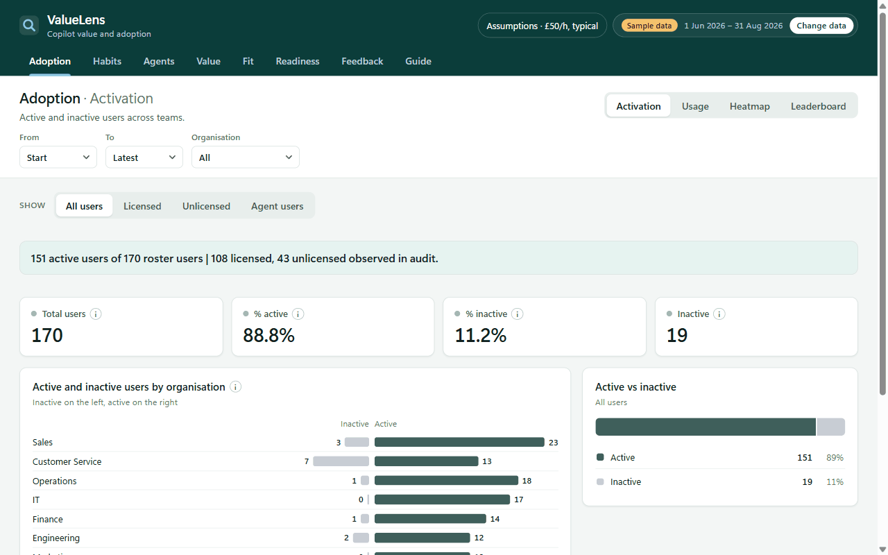
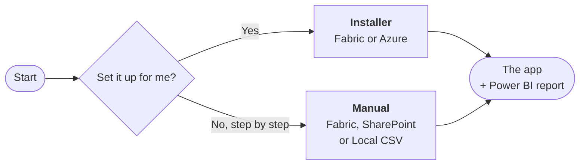

 

# 🔍 ValueLens for Microsoft Copilot

**The hours and value Microsoft 365 Copilot and agents deliver, as an app or a Power BI report.**

 

All reports and guides can be found on the [Analytics Hub](https://microsoft.github.io/Analytics-Hub/).

**Also see [Analytics Hub for Microsoft Copilot](https://github.com/microsoft/AnalyticsHub-Dashboard):**
one installer sets up an app on Microsoft Fabric or Azure that shows Copilot and agent adoption,
value, consumption and governance in one place. It includes the ValueLens report.

 

**Found this useful? ⭐ Star this repo to help others discover it!**

 

**[Before you start ↓](#before-you-start)** &nbsp;·&nbsp; **[Choose your path ↓](#choose-your-path)** &nbsp;·&nbsp; **[After setup ↓](#after-setup)** &nbsp;·&nbsp; **[Watch the demo ↗](https://youtu.be/P0uHJb13ZR0)**

 

<table>
<tr>
<th width="50%">The app</th>
<th width="50%">The Power BI report</th>
</tr>
<tr>
<td></td>
<td></td>
</tr>
</table>

All screenshots use synthetic sample data. Every name in them is invented.

## Videos

- **[Watch the demo](https://youtu.be/P0uHJb13ZR0)** (2 minutes). What the dashboard shows, page by page.
- **[Watch the Fabric setup](1.%20Fabric/README.md#video)**. From a new app registration to a self-refreshing report.
  Or [download the video](https://github.com/microsoft/ValueLens-for-Microsoft-Copilot/releases/download/installer-v0.2.2/ValueLens_Fabric_Setup.mp4).

## What you get

- **An app** that shows how your organisation uses Microsoft 365 Copilot and agents.
- **The hours and value** they deliver, by team, tool and task.
- **A Power BI report** with the same numbers.

> **Just looking?** Open the [app on your PC](app/download/ValueLens-App.html)
> (choose **Download raw file**, then open it in Edge or Chrome). It runs on sample data.

## Before you start

- [ ] **Licences:** Power Apps Premium or Copilot Credits (app), Power BI Pro (report).
- [ ] **A home for the data:** Fabric F2+ ([free trial](https://learn.microsoft.com/fabric/fundamentals/fabric-trial#method-1-start-a-new-trial-capacity-from-the-account-manager)), Azure, SharePoint, or your PC.
- [ ] **Admins:** a Global Admin approves read-only Graph access; a Power Platform Admin allows managed apps.
- [ ] **Tools:** Windows 10/11, Power BI Desktop (June 2024+). For the app: Node.js 24.11+, Git, `ms`.
- [ ] **The [disclaimer](#disclaimer):** not the official Copilot report; you own the extracted data.

Full list, by who does what: [Before you start](docs/PREREQUISITES.md) · [Permissions](docs/PERMISSIONS.md).

## Choose your path

| Path | Best for |
|---|---|
| **[Installer](#installer)** (recommended) | Most people. Answer a few questions; it does the rest. |
| **[Manual](#manual)** | Full control, or if you can't run the installer. |

## Installer

> A ValueLens installer is [coming soon (#216)](https://github.com/microsoft/ValueLens-for-Microsoft-Copilot/pull/216).
> Until then, use the Analytics Hub installer (work in progress: try a test tenant first).

1. **Send each admin** their part of the [checklist](docs/PREREQUISITES.md).
2. **Download and open** [AnalyticsHubInstaller.exe](https://github.com/microsoft/ValueLens-for-Microsoft-Copilot/releases/latest/download/AnalyticsHubInstaller.exe)
   ([warning?](1.%20Fabric/installer/README.md#check-the-download)). It opens in your browser; keep its window open.
3. **Choose Set up Analytics Hub** and sign in.
4. **Answer the questions:** Fabric or Azure, then your data. **No** to advanced settings keeps the defaults.
5. **Approve the plan.** Nothing is created until you do. Setup takes about 15 minutes.
6. **Open the app link.** The first data arrives about 25 minutes later.

More: [Fabric](1.%20Fabric/README.md#installer) · [Azure](2.%20Azure/README.md#install-it) ·
[installer reference](1.%20Fabric/installer/README.md)

## Manual

1. **Collect the data** with one path:
   **[1. Fabric](1.%20Fabric/)** (recommended) · **[4. SharePoint](4.%20SharePoint/)** ·
   **[5. Local CSV](5.%20Local%20CSV/)** (Power BI Desktop only, sample data included).
   [2. Azure](2.%20Azure/) is installer only.
2. **[Deploy the app](app/README.md#as-a-copilot-managed-app)** with the `ms` tool, once an admin turns on two settings.
3. **Share it.** Viewers choose **Change data** and pick [the CSV files](app/README.md#data) from step 1.
4. **Optional:** publish the Power BI report (every path has it), or [add extras](1.%20Fabric/README.md#optional-extras).

## After setup

- **Check it worked:** the app no longer says **Sample data**.
- **Keep it fresh:** Fabric and Azure run on a schedule, SharePoint daily, Local CSV when you re-export.
  Reopen the installer for status and repairs.
- **Read the numbers:** [interpretation guide (PDF)](docs/ValueLens-Report-Interpretation-Guide.pdf) ·
  [how value is calculated](docs/METHODOLOGY.md).
- **Get help:** [open an issue](https://github.com/microsoft/ValueLens-for-Microsoft-Copilot/issues) · [Support](SUPPORT.md).

---

<strong>Disclaimer</strong>

 

- **This isn't the official Copilot report.** The official sources are the
  [Microsoft 365 admin center Copilot usage reports](https://learn.microsoft.com/en-us/microsoft-365/admin/activity-reports/microsoft-365-copilot-usage)
  and the [Viva Insights Copilot Dashboard](https://learn.microsoft.com/en-us/viva/insights/org-team-insights/copilot-dashboard).
  ValueLens takes its Copilot figures mainly from the Purview audit log, which isn't the
  authoritative source, so its numbers may not always match those reports exactly.
- **You're responsible for the data once it's extracted.** ValueLens copies data into your own
  Fabric, Azure, Dataverse, SharePoint or CSV files. The retention, deletion and other policies you
  set in Purview, Microsoft 365, Entra ID, Dataverse and the other sources don't apply to those
  copies. Managing that data and meeting your organisation's requirements is up to you.

**Usage and compliance.** While this tool helps customers understand the business value of their AI
usage data, Microsoft has **no visibility** into the data customers input, nor control over how the
template is used. Customers are solely responsible for ensuring their use complies with all
applicable laws and regulations (including data privacy and security). **Microsoft disclaims all
liability** arising from use of this template.

This is an **experimental** template with Purview audit logs as the primary source. Audit logs
provide visibility into Copilot/agent interactions but are not intended as the sole source of truth
for licensing or full‑fidelity reporting. Not supported through Microsoft support channels — please
open an issue in this repo.

<strong>The Power BI report and add-ons</strong>

 

- **Quick look:** [5. Local CSV](5.%20Local%20CSV/) with its sample data. Two minutes, no tenant access.
- **Desktop version:** June 2024 or later. Older releases show errors on the Habit Formation page
  ([why](5.%20Local%20CSV/README.md)). The Power BI service and Fabric aren't affected.
- **Guide:** the [report interpretation guide (PDF)](docs/ValueLens-Report-Interpretation-Guide.pdf)
  explains all 15 pages.

Add-ons:

- **Credit consumption and cost:** an `Add Credit Consumption` folder in each path
  ([Fabric](1.%20Fabric/Manual%20setup/Add%20Credit%20Consumption/)).
- **Copilot Studio conversations:** [Agent Evaluator](1.%20Fabric/Manual%20setup/Add%20Agent%20Evaluator/) (Fabric).
- **Shadow AI and agent risk:** the [Defender notebook](1.%20Fabric/Manual%20setup/notebooks/README.md#optional-notebooks)
  (Fabric). Needs Defender for Endpoint P2 or Defender for Cloud Apps, and fills the Governance page's
  Shadow AI section ([details](1.%20Fabric/installer/README.md#defender-shadow-ai-and-agent-risk)).

<strong>Other ways to host the app: the Fabric App</strong>

 

Host the dashboard in your own Fabric workspace instead (preview). You need a workspace on Fabric
capacity (F2 or larger, or a trial; not *My workspace*) and the **Fabric Apps (preview)** tenant setting.

- **[Analytics Hub app](1.%20Fabric/Fabric%20App/):** reads your published semantic model live, as the
  viewer, so row-level security applies. The [installer](1.%20Fabric/installer/README.md) deploys it.
- **[`fabric-app/`](fabric-app/README.md):** reads the ValueLens and
  [Consumption Central](https://github.com/microsoft/ConsumptionCentral-for-Microsoft-Copilot) models
  live and keeps no copy of your data. Deploy with `npm run deploy:vl`, `deploy:cc` or `deploy:both`
  (add `--dry-run` first). The same folder is kept in the Consumption Central repo.
- **[The app, in Fabric](app/README.md#as-a-fabric-app-in-a-fabric-workspace):** the same `app/` code and CSV files.

The first two also need the **Semantic Model Execute Queries REST API** tenant setting.

<strong>Troubleshooting</strong>

 

- [Installer](1.%20Fabric/installer/README.md#troubleshooting)
- [Fabric notebooks: an audit window keeps failing](1.%20Fabric/Manual%20setup/notebooks/README.md#an-audit-window-keeps-failing)
- [SharePoint](4.%20SharePoint/README.md#troubleshooting) · [Local CSV](5.%20Local%20CSV/README.md#troubleshooting)
- [The app](app/README.md#as-a-copilot-managed-app): admin settings, licences and timeouts

<strong>Reference</strong>

 

- [How the value is calculated](docs/METHODOLOGY.md) · [Data dictionary](docs/DATA-DICTIONARY.md) ·
  [Audit log coverage](docs/AUDIT-LOG-COVERAGE.md)
- [Before you start](docs/PREREQUISITES.md) · [Permissions](docs/PERMISSIONS.md) ·
  [Analytics Hub app guide](docs/APP-GUIDE.md)
- [Report interpretation guide (PDF)](docs/ValueLens-Report-Interpretation-Guide.pdf) ·
  [Installer reference](1.%20Fabric/installer/README.md) (work in progress)
- [What changed](CHANGELOG.md) · [Support](SUPPORT.md) · [Security](SECURITY.md) ·
  [Contributing](CONTRIBUTING.md) · [MIT licence](LICENSE)

<strong>Archived options</strong>

 

- **[Power Automate + Dataverse](archive/3.%20Power%20Automate%20%2B%20Dataverse/README.md)** (path 3)
  was archived on 23 October 2026. Existing installs keep running, with no updates or support.
  For a new install, [choose another path](#choose-your-path).
- Older report templates are in [`archive/`](archive/).

