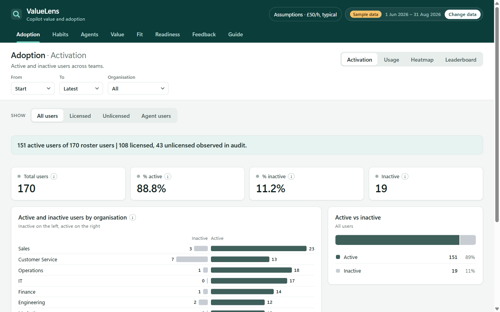
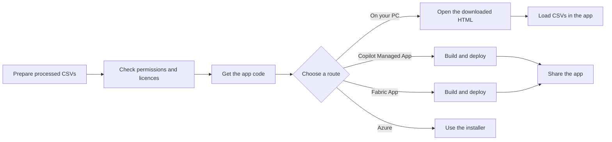

# ValueLens app

The ValueLens dashboard as an app (preview). It shows the same numbers as the Power BI report,
with the same DAX rules ported to TypeScript, in seven tabs instead of sixteen pages.

It runs in the browser. Your CSV files are read on your PC, and no data is sent anywhere.



## Choose a route

This app reads processed CSV files in your browser. You do not need a Power BI licence.

| Route | Choose it when | What you need |
|---|---|---|
| **On your PC** | You want to try it or use it by yourself | Edge or Chrome. Works offline. |
| **Copilot Managed App** (preview) | You want to share the app with people | An admin to allow CLI apps; Node.js and Git; viewers need Power Apps Premium or Copilot Credits. |
| **Fabric App** (preview) | You have a Fabric workspace and want to host the app there | Node.js and Git; a workspace on Fabric capacity (F2 or larger, or a trial); the **Fabric Apps (preview)** setting. |
| **Azure** | You need the Azure-hosted Analytics Hub | Use the [installer](../2.%20Azure/README.md). Azure is not a manual hosting route for this CSV app; the installer deploys a different app. |

## How setup works



## Before you start

- **Prepare the data.** Have the processed interactions CSV ready. Add the user, agent registry,
  and feedback CSVs if you have them. See [which files the app reads](#which-files-the-app-reads).
- **Choose who can open the app.** For the Managed App, each viewer needs Power Apps Premium or
  Copilot Credits. Microsoft 365 Copilot by itself is not enough. For Fabric, the workspace admin
  must enable **Fabric Apps (preview)** and the workspace must use Fabric capacity (F2 or larger,
  or a trial). *My workspace* does not work.
- **Get permission before you start.** Ask a Global or Power Platform Administrator to allow
  Managed App creation for the Managed App route. For Fabric, use a workspace where you are allowed
  to deploy and share an app.
- **Install the tools for your route.** The Managed App route needs Node.js 24.11 or later and Git.
  The Fabric route needs Node.js 24.15 or later (or 22.22 or later) and Git. The PC route needs no
  developer tools.

## Set up the app

### On your PC

1. Open [`download/ValueLens-App.html`](download/ValueLens-App.html) in GitHub.
2. Select **Download raw file** and save the file to your PC.
   - **Success:** the saved file is named `ValueLens-App.html`.
   - **If this fails:** choose **Download raw file**, not **Raw**; opening the raw view can show code instead of saving the app.
3. Open the saved file in Edge or Chrome.
   - **Success:** the app opens and shows labelled sample data. It works offline.
   - **If this fails:** make sure the browser opened the downloaded `.html` file, not the GitHub page.
4. In the app, select **Change data** and choose your CSV files.
   - **Success:** the dashboard shows your data instead of the sample.
   - **If this fails:** check that the interactions file is processed and matches the [required columns](#which-files-the-app-reads).

### Copilot Managed App

1. Ask a Global or Power Platform Administrator to open the
   [Power Platform admin center](https://admin.powerplatform.microsoft.com) and go to **Copilot** >
   **Settings** > **Managed apps**.
2. Ask the administrator to turn on both settings for your environment or its group:
   **Allow app creation with the Copilot Managed Runtime command line interface (CLI)** and
   **External artifacts in managed apps**.
   - **Success:** both settings show as on.
   - **If this fails:** ask the administrator to check that they selected the environment you will use.
     Both settings are off by default. See
     [the CLI app settings](https://learn.microsoft.com/microsoft-365/admin/manage/apps/governance#control-whether-apps-can-be-created-using-the-cli).
3. Install [Node.js 24.11 or later](https://nodejs.org/) and [Git](https://git-scm.com/downloads).
   Check that both are ready:

   ```powershell
   node --version
   git --version
   ```

   - **Success:** Node.js shows version 24.11 or later, and Git prints its version.
   - **If this fails:** install the missing tool, then close and reopen PowerShell.
4. Open PowerShell and install the Microsoft `ms` tool:

   ```powershell
   npm.cmd install -g @microsoft/managed-apps-cli@0.29.0
   ```

5. Check that the tool is ready:

   ```powershell
   ms.cmd --version
   ```

   - **Success:** the version is `0.29.0`.
   - **If this fails:** close and reopen PowerShell. If it still fails, check that Node.js installed
     correctly. Using `npm.cmd` and `ms.cmd` avoids PowerShell script-policy errors.
6. Sign in to the environment where the app will live:

   ```powershell
   ms.cmd auth login
   ```

   - **Success:** the browser confirms sign-in and PowerShell returns to the prompt.
   - **If this fails:** complete the sign-in in the browser. If no browser can open, run
     `ms.cmd auth login --device-code`.
7. Download the app code:

   ```powershell
   git clone https://github.com/microsoft/ValueLens-for-Microsoft-Copilot.git
   ```

   - **Success:** a `ValueLens-for-Microsoft-Copilot` folder appears in the current folder.
   - **If this fails:** install Git, reopen PowerShell, and run the command again.
8. Go to the app folder:

   ```powershell
   cd .\ValueLens-for-Microsoft-Copilot\app
   ```

9. Install the app's required files:

   ```powershell
   npm.cmd ci
   ```

   - **Success:** the command finishes and returns to the prompt.
   - **If this fails:** check that PowerShell is in the `app` folder and Node.js is installed.
10. Set up the app for local build and upload:

    ```powershell
    ms.cmd app init -n "ValueLens" --repo none -b .\dist -S "npm run build"
    ```

    `--repo none` means the app is built on your PC and then uploaded. The **External artifacts**
    setting in step 2 is needed for this. This uses your personal developer environment. If your
    administrator gave you a different environment, use this command instead and paste its ID:

    ```powershell
    $environmentId = Read-Host "Paste the environment ID"
    ms.cmd app init -n "ValueLens" --repo none -b .\dist -S "npm run build" -e $environmentId
    ```

    - **Success:** setup finishes without an error and creates a local `ms.config.json`.
    - **If this fails:** check the sign-in, both admin settings, and that you are in the `app` folder.
11. Build and deploy the app:

    ```powershell
    ms.cmd app deploy
    ```

    - **Success:** the command finishes without an error. The app is available at
      [managedapps.cloud.microsoft](https://managedapps.cloud.microsoft).
    - **If this fails:** check that your account can create apps in the selected environment and
      that you used the correct environment when setting up the app.
12. Share the app with people or groups. Enter their email addresses, separated by commas, when
    PowerShell asks:

    ```powershell
    $viewers = Read-Host "Enter viewer emails, separated by commas"
    ms.cmd app share $viewers
    ```

    - **Success:** the command confirms the share. Viewers can find **ValueLens** at
      [managedapps.cloud.microsoft](https://managedapps.cloud.microsoft).
    - **If this fails:** check the email addresses and that you are signed in to the right environment.
      Sharing gives access, not a licence.
13. Ask viewers to open **ValueLens** and select **Change data** to load their CSV files.
    Each viewer also needs Power Apps Premium or Copilot Credits.

### Fabric App

1. Ask a Fabric administrator to turn on **Fabric Apps (preview)** in the Fabric admin portal's
   tenant settings.
   - **Success:** the setting is on.
   - **If this fails:** only a Fabric administrator can change tenant settings.
2. Open the Fabric workspace where the app will live. Confirm it is assigned to Fabric capacity
   (F2 or larger, or a trial); do not use *My workspace*.
   - **Success:** the workspace shows its capacity.
   - **If this fails:** ask the workspace or capacity administrator to assign a capacity.
3. Install [Node.js 24.15 or later](https://nodejs.org/) (or 22.22 or later) and
   [Git](https://git-scm.com/downloads). Check that both are ready:

   ```powershell
   node --version
   git --version
   ```

   - **Success:** Node.js shows version 24.15 or later (or 22.22 or later), and Git prints its version.
   - **If this fails:** install the missing tool, then close and reopen PowerShell.
4. Open PowerShell and download the app code:

   ```powershell
   git clone https://github.com/microsoft/ValueLens-for-Microsoft-Copilot.git
   ```

5. Go to the app folder:

   ```powershell
   cd .\ValueLens-for-Microsoft-Copilot\app
   ```

6. Install the app's required files:

   ```powershell
   npm.cmd ci
   ```

   - **Success:** the command finishes and returns to the prompt.
   - **If this fails:** check that you are in the `app` folder and Node.js is installed.
7. Check what Rayfin plans to deploy. When prompted, sign in and enter the tenant and workspace
   IDs. Copy the workspace ID from the workspace URL; ask your administrator for the tenant ID.

   ```powershell
   $tenantId = Read-Host "Paste your tenant ID"
   $workspaceId = Read-Host "Paste your Fabric workspace ID"
   npx.cmd rayfin up --tenant $tenantId --workspace-id $workspaceId --dry-run
   ```

   - **Success:** Rayfin shows the planned app without deploying it.
   - **If this fails:** check the IDs, sign-in, workspace capacity, and the tenant setting in step 1.
8. Build and deploy the app to the workspace:

   ```powershell
   npx.cmd rayfin up --tenant $tenantId --workspace-id $workspaceId
   ```

   Review and approve the deployment if prompted.
   - **Success:** Rayfin prints a link to the app in the Fabric portal. Open it to see the sample data.
   - **If this fails:** make sure your account can deploy apps to that workspace. Ask the Fabric
     administrator to check the tenant setting and capacity.
9. In the Fabric workspace, find the app, select **…** > **Share**, add the people or group, and
   choose **Grant**.
   - **Success:** a viewer can open the item link.
   - **If this fails:** check that the viewer was added to the app item, not just sent the link.
10. Ask viewers to select **Change data** and choose their CSV files.
    - **Success:** the dashboard shows their data instead of the sample.
    - **If this fails:** check that the interactions file is processed and has the
      [required columns](#which-files-the-app-reads).

To update the Fabric App after changing the code, run `npx.cmd rayfin up` again from the `app`
folder. Rayfin keeps deployment state in gitignored local files.

## What manual setup does not do

These manual routes host only the CSV dashboard. They do not collect or process data, create a
semantic model or Power BI report, schedule data refresh, or create a viewer group. You provide the
processed CSV files, share the app yourself, and viewers load their own files in the browser.

The [Analytics Hub installer](../1.%20Fabric/installer/README.md) sets up a different app with a
data pipeline and a live semantic model. Use the [Azure setup guide](../2.%20Azure/README.md) for
the Azure installer route.

## Data

### Which files the app reads

The same CSV files as the **Local CSV** and **SharePoint** paths. Choose **Change data** and drop
them in. The app tells each file's type from its column headers.

| File | Detected by | Needed? | Local CSV / SharePoint file |
|---|---|---|---|
| Copilot interactions | `ThreadId` plus `Audit_UserId` or `Message_isPrompt` | **Required** | `*_Interactions_*.csv` or `copilot_interactions_rollup.csv` |
| Organisation and licences | A user key (`PersonId` or `UserPrincipalName`), plus `Organization` or `Has License` | Recommended: organisation filter, licensed counts, Readiness tab | `*_Users_*.csv` or `copilot_users_rollup.csv` |
| Agent 365 registry | `Agent name` | Optional: Agents tab and agent lifecycle | `Agents365Registry.csv` or `agents_365.csv` |
| Product feedback | `Feedback Type` or `Feedback Id` | Optional: Feedback tab | `product_feedback.csv` |

The interactions file must be the **processed** output, not the raw Purview export. It needs the
processor's derived columns, such as `Behavior_Enriched_Full`, `Value_Outcome`, `Expertise_Role`,
`AI_Model`, `Agent_Type` and `License Status`. Two paths already produce these files, and most others
share the processor, so every active path has one input format.

### Getting the files from each variant

| Path | How to get the CSVs |
|---|---|
| 5. Local CSV | The processor's `*_Interactions_*.csv` and `*_Users_*.csv`, plus the optional agent and feedback exports. |
| 4. SharePoint + PAX | `copilot_interactions_rollup.csv`, `copilot_users_rollup.csv` and `agents_365.csv` from the folder `Upload-Rollups-SharePoint.ps1` writes to. |
| 1. Fabric | Export the Lakehouse tables from a notebook, e.g. `spark.table("copilot_interactions_curated").toPandas().to_csv(...)`. For users, export org data with a UPN, `Organization` and `Has License`. |
| 2. Azure | The run job writes the same curated table to `curated/copilot_interactions_curated` and Azure SQL. Export it the same way, or run the Local CSV processor on a Purview export. |
| 3. Power Automate + Dataverse ([archived](../archive/3.%20Power%20Automate%20%2B%20Dataverse/README.md)) | Its Dataverse columns are prefixed. Run [`Purview_CopilotInteraction_Processor`](../5.%20Local%20CSV/scripts/) on a Purview audit export instead, and add `agents_365.csv` if you use one. |

### Sample data

The app shows a synthetic sample, labelled **Sample data**, until you load your own files.
`npm run dev`, `build` and `build:file` first run `scripts/prepare-sample.mjs`, which builds it in
`public/sample/` from `5. Local CSV/sample-data` (git ignores the output, so build from a full clone).

The sample registry has no `Total Users` column, so agent lifecycle and usage review fall back to
users seen in the audit log. Your own registry export does the same if it lacks that column.

## Tabs

| Tab | Views | Power BI pages it replaces |
|---|---|---|
| Adoption | Activation, Usage, Heatmap, Leaderboard | Activation, Adoption, Trend Heatmap, Leaderboard |
| Habits | — | Habit Formation |
| Agents | — | Agent Registry |
| Value | Tasks, Estimated value, Signal map | Task Breakdown, Estimated Value, Appendix: Signal - Impact Table |
| Fit | Cowork fit, Model fit | Cowork Fit, Model Fit |
| Readiness | Licences, Cowork | License Readiness and License Allocation (combined), Cowork Readiness |
| Feedback | — | User Feedback |
| Guide | — | Appendix: Glossary, plus the differences from Power BI |

- **Filters:** only those that apply to the current view show (dates, organisation, licence, tool,
  agent type, agent, creator). One that doesn't apply is cleared when you switch.
- **Info buttons** show each metric's glossary definition.
- **Assumptions** (in the header) replace the report's parameter tables: hourly rate, currency,
  licence price, effort scenario and Cowork grading. The one licence price drives investment, return and reclaimable seats. Changes apply everywhere.

## Differences from Power BI

The Guide tab lists these too. The values are unchanged.

- Treemaps, donuts and pies are ranked bars or a single proportion bar.
- The activation chart is a two-sided bar.
- Tabs and views replace bookmarks and the page navigator.
- Behaviour charts on the agent lens hide agents with fewer than two users (a privacy floor).

## Develop

```powershell
npm install
npm run dev         # local dev server
npm run lint
npm test            # unit tests for the upload checks (Node 24, no install needed)
npm run build       # type-check and build to dist/ (Fabric App and Managed App hosting)
npm run build:file  # build the single-file download to download/ValueLens-App.html
```

`download/ValueLens-App.html` is committed so people can download it. After any app change, run
`npm run build:file` and commit the result. It inlines the code and styles and embeds the sample
CSVs gzipped, so it needs no server and makes no network calls.

`scripts/extract-model-tables.py` re-extracts the glossary, behaviour value map and human time
estimates from the report into `src/data/*.json`. Run it when those tables change in the `.pbit`.

| Folder | Holds |
|---|---|
| `src/data/` | CSV loading, header detection and the report's reference tables |
| `src/metrics/` | The DAX port, one module per report area |
| `src/ui/` | The design kit |
| `src/pages/` | The tabs |

Design system: [DESIGN.md](DESIGN.md). Product brief: [PRODUCT.md](PRODUCT.md).
