# App guide

What each page of the Analytics Hub app answers, what it reads, and how to read it. Each page is a
short run of sections, top to bottom. The sidebar jumps to any of them.

Screenshots use synthetic data. Every name in them is invented.

- **Filters** sit in the bar at the top. A page uses only the ones that apply to it.
- **Optional** pages appear only once their data has loaded.
- **How each figure is worked out** is in the [methodology](METHODOLOGY.md). Table and column names
  are in the [data dictionary](DATA-DICTIONARY.md).

| Page | Answers |
|---|---|
| [Executive summary](#executive-summary) | What is Copilot delivering, and where? |
| [Adoption](#adoption) | Who started, who stayed, who stuck? |
| [Leaderboards](#leaderboards) | Which people and agents do the most? |
| [Work patterns](#work-patterns) | How do people work across Microsoft 365, and where does Copilot fit? |
| [Agent Evaluation](#agent-evaluation) | How well do our agents answer, and where do they fall short? |
| [Governance](#governance) | Who owns our agents, who can reach them, and what needs a review? |
| [Readiness](#readiness) | Who should get a licence next, and who is ready for Cowork? |
| [Consumption](#consumption) | What credits did we use, and what did they cost? |
| [Value](#value) | What was the work, and what was it worth? |
| [Efficiency](#efficiency) | Is the right tool doing the job? |
| [Feedback](#feedback) | What do people say about it? |
| [Assumptions](#assumptions) | How long would each task take without Copilot? |
| [Appendix](#appendix) | What does each metric mean? |

---

## Executive summary

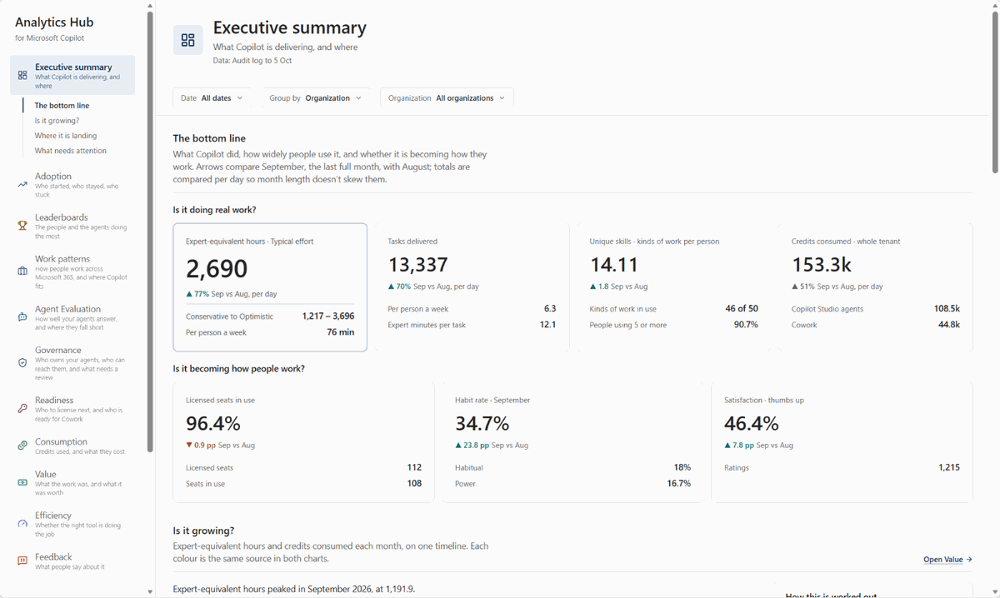

**Answers:** what Copilot is delivering, and where. The app opens here. Each panel links to the page
that tells that part in full.

**Reads:** the Purview audit log, org data and product feedback, plus credits from Consumption
Central when it's installed. **Filters:** dates, organisation.

| Section | What it shows |
|---|---|
| The bottom line | Active users, hours saved and estimated value, and whether you can trust the numbers |
| Is it growing? | Monthly trend, and whether it is becoming how people work |
| Where it is landing | The departments, apps and agents carrying the use |
| What needs attention | Decisions the data points to, the most people or hours affected first |

## Adoption

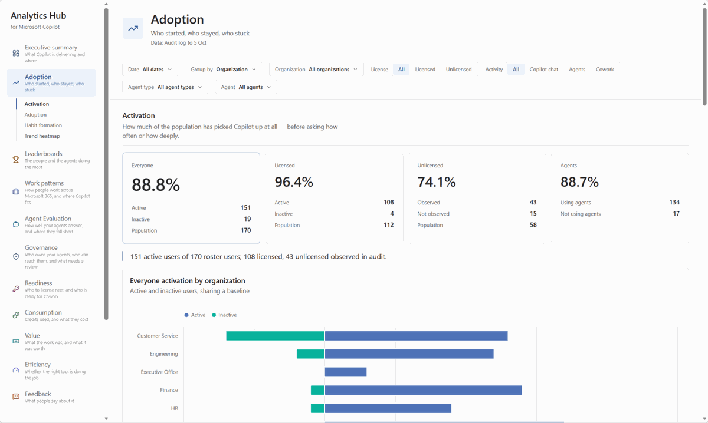

**Answers:** who started, who stayed and who stuck.

**Reads:** the audit log, org data and the Agent 365 registry. **Filters:** all.

| Section | What it shows |
|---|---|
| Activation | How much of the population has picked Copilot up at all |
| Adoption | How often active people come back, the same way across every surface |
| Habit formation | Where people sit on the ladder from licensed but idle to daily use |
| Trend heatmap | Where and when use is concentrating or fading, week by week |

## Leaderboards

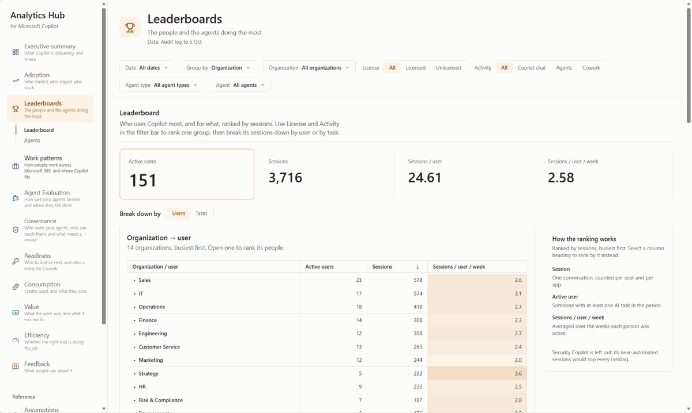

**Answers:** which people and agents do the most.

**Reads:** the audit log, org data and the Agent 365 registry (for the agent columns).
**Filters:** all.

| Section | What it shows |
|---|---|
| Leaderboard | Who uses Copilot most, and for what, ranked by sessions |
| Agents | Which agents people actually use, and what each one is for |

## Work patterns

*Optional: needs Microsoft 365 activity.*

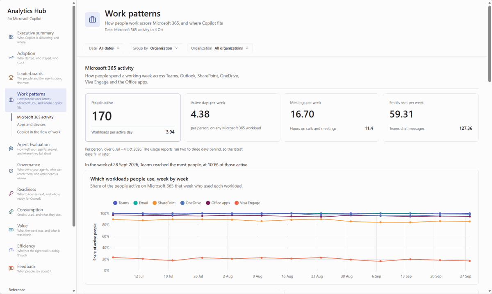

**Answers:** how people work across Microsoft 365, and where Copilot fits.

**Reads:** the Microsoft 365 usage reports, licences and the audit log. **Filters:** dates,
organisation.

| Section | What it shows |
|---|---|
| Microsoft 365 activity | Who is active in each workload |
| Apps and devices | Which apps and devices people use |
| Copilot in the flow of work | Copilot use set against everyday Microsoft 365 work |

## Agent Evaluation

*Optional: needs the Agent Evaluator add-on.*

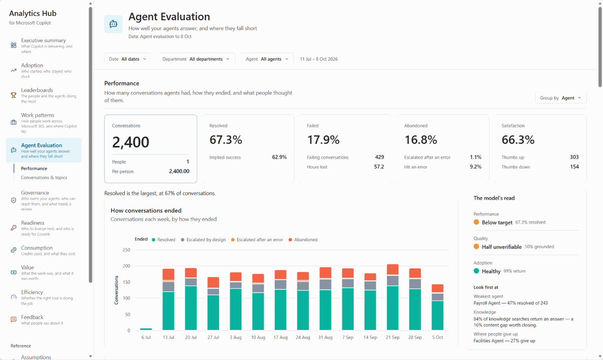

**Answers:** how well your Copilot Studio agents answer, and where they fall short.

**Reads:** the Agent Evaluator model, built from the Copilot Studio transcripts in Dataverse. It
never shows the conversations themselves. **Filters:** its own.

| Section | What it shows |
|---|---|
| Performance | Conversations, how they ended, errors and hand-offs, and what people thought |
| Conversations & topics | What people asked about, where answers came from, and what to fix first |

## Governance

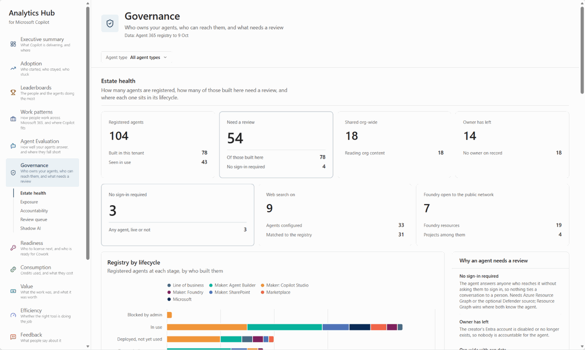

**Answers:** who owns your agents, who can reach them, and what needs a review.

**Reads:** the Agent 365 registry and Azure Resource Graph, plus Microsoft Defender for Shadow AI.
Without them, it says how to connect them. **Filters:** agent type.

| Section | What it shows |
|---|---|
| Estate health | Registered agents, how many need a review, and their lifecycle stage |
| Exposure | Who can reach each agent, against what it can read |
| Accountability | Whether each agent's creator is still here to answer for it |
| Review queue | The agents to review, and why |
| Shadow AI | Other AI tools seen on managed devices (needs the Defender add-on) |

## Readiness

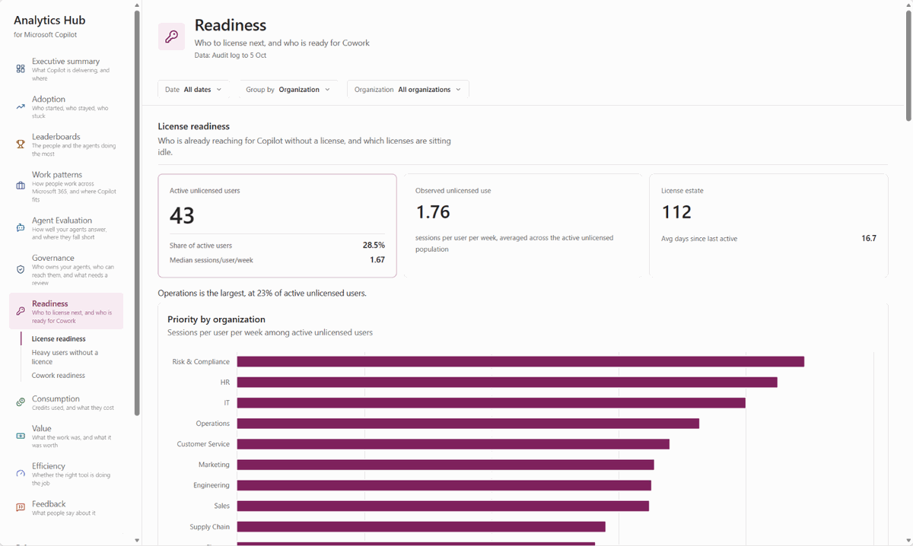

**Answers:** who to license next, and who is ready for Cowork.

**Reads:** the audit log, licences, org data and Microsoft 365 activity. **Filters:** dates,
organisation.

| Section | What it shows |
|---|---|
| License readiness | Who already reaches for Copilot without a licence, and which licences sit idle |
| Heavy users without a licence | Last month's users, by how often they used Copilot and whether they had a licence |
| Cowork readiness | Who to offer Cowork next, by how broad and deep their everyday use is |

## Consumption

*Optional: needs the Credit consumption add-on.*

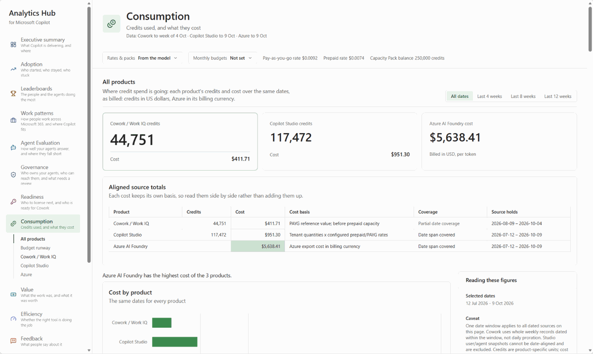

**Answers:** what credits you used, and what they cost.

**Reads:** the Consumption Central model: Cowork / Work IQ and Copilot Studio credits, and Azure
and Foundry cost. **Filters:** its own. **Settings:** rates, Capacity Packs and monthly budgets.

| Section | What it shows |
|---|---|
| All products | Each product's credits and cost over the same dates |
| Budget runway | This month's spend against your budgets, and where the month will end |
| Cowork / Work IQ | Credits by week and by person |
| Copilot Studio | Credits by agent, model and feature, and how concentrated they are |
| Azure | Azure and Foundry cost by day, service, model and resource |

## Value

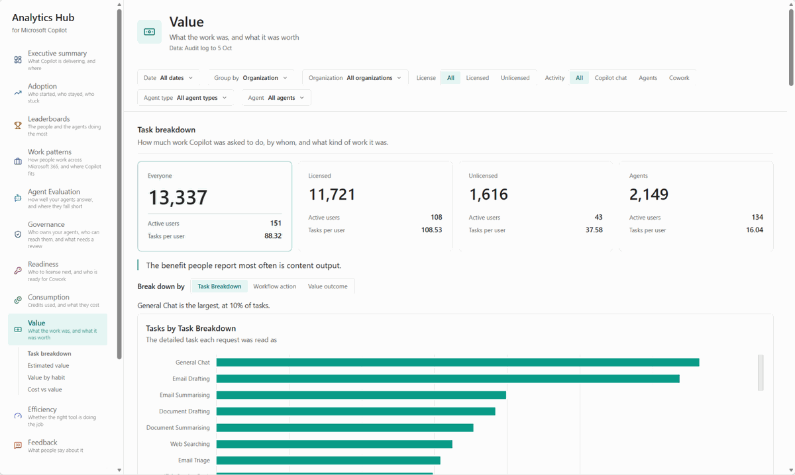

**Answers:** what the work was, and what it was worth.

**Reads:** the audit log, org data and the [time per task](#assumptions). **Filters:** all.
**Settings:** licence price, currency and exchange rate.

| Section | What it shows |
|---|---|
| Task breakdown | The tasks Copilot did, by category |
| Estimated value | Hours saved and their value |
| Value by habit | Value by how often people use Copilot |
| Cost vs value | What Copilot cost over these dates, against the value of its work |

## Efficiency

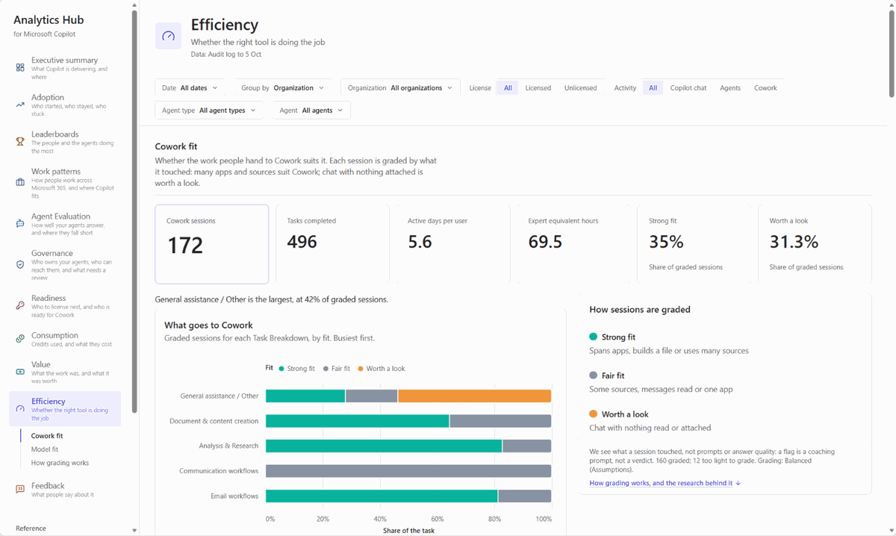

**Answers:** whether the right tool is doing the job.

**Reads:** the audit log and org data. It grades what a session touched, never the prompt or the
answer. **Filters:** all.

| Section | What it shows |
|---|---|
| Cowork fit | Whether the work people hand to Cowork suits it |
| Model fit | Whether the model doing the work suits it |
| How grading works | The rules behind both grades |

## Feedback

*Optional: needs product feedback.*

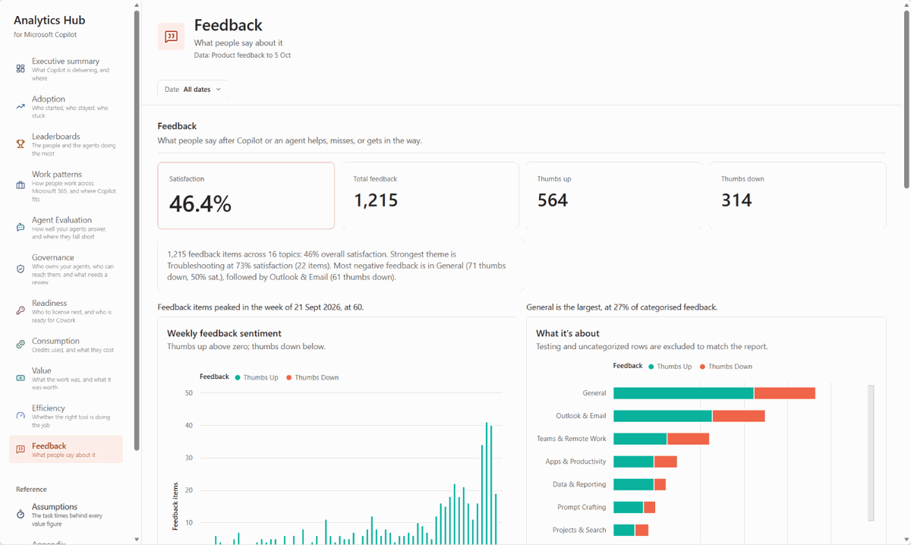

**Answers:** what people say after Copilot or an agent helps, misses or gets in the way.

**Reads:** the Microsoft 365 admin center product feedback export. **Filters:** dates.

## Assumptions

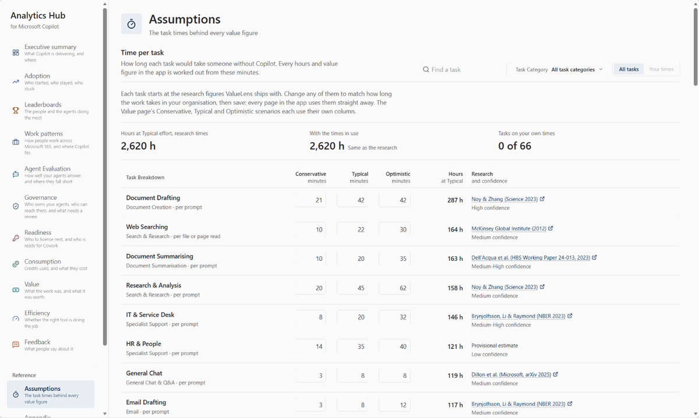

**Answers:** how long each task would take without Copilot. Every hours and value figure uses these
minutes.

**Reads:** the model's task times. **Settings:** change any time; **Use research** puts them back.

## Appendix

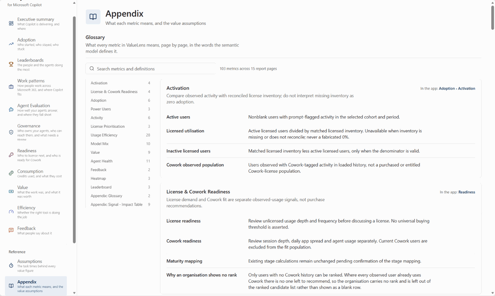

**Answers:** what each metric means, and the assumptions behind value.

| Section | What it shows |
|---|---|
| Glossary | Every metric, in the model's own words |
| Signal → Impact | What the audit log shows, the task it is read as, and that task's human time |
